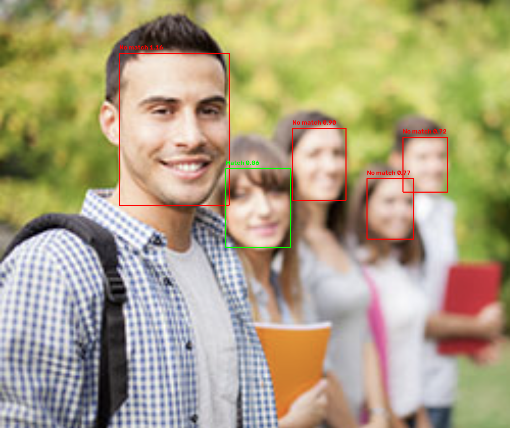

# Face recognition: is this person in the group photo?

Given a photo of one person and a group photo, this program finds every face in the group, compares each one to the individual, and saves an annotated copy of the group photo: a green box on a match, red on everyone else, with the similarity score on each box.

| Person is in the group | Person is not in the group |
|---|---|
|  |  |

## How it works

1. **Detect and align faces** with RetinaFace, in both photos, using the same preprocessing.
2. **Turn each face into a 512-number embedding** with FaceNet-512. Photos of the same person land close together; different people land far apart.
3. **Compare with cosine distance.** Below 0.30 (DeepFace's published threshold for FaceNet-512) counts as a match.
4. **Annotate and save** the group photo.

## Results

| Test | Closest face distance | Next closest | Result |
|---|---|---|---|
| Person cropped from the group | 0.059 | 0.720 | Match found |
| Different person | 0.837 | 1.005 | No match |

The gap between a true match (0.06) and everyone else (0.72+) is wide, so the 0.30 threshold separates them cleanly.

## What I fixed from the first version

The first version of this project, written for a graduate course, gave wrong answers. Debugging it was the most useful part of the project:

- **Mismatched preprocessing.** Group faces were cropped by one function and re-embedded without detection, while the individual went through full detection and alignment. Every comparison came out near 1.0, so a real match could never be found.
- **False faces.** OpenCV's Haar-based detector flagged a hand and a backpack strap as faces. Switching to RetinaFace, filtering low-confidence detections and using the largest face in the individual photo fixed it.
- **Model choice.** I tested FaceNet, FaceNet-512 and ArcFace on the same images. FaceNet-512 separated a true match from strangers most clearly.

## Run it

```bash
pip install -r requirements.txt
python face_match.py --individual individual.png --group group.png
python face_match.py --individual person_from_group.png   # a true match
```

Add `--show` to open a preview window. Model weights download automatically on the first run.

## Built with

Python, DeepFace, FaceNet-512, RetinaFace, OpenCV, NumPy
